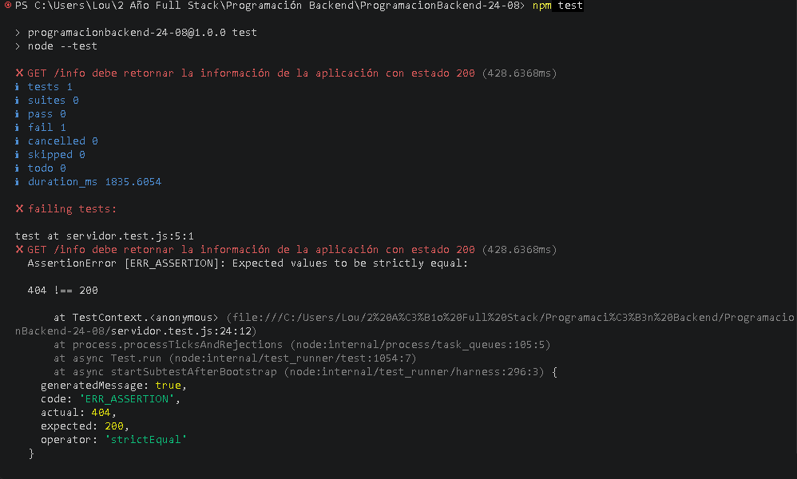
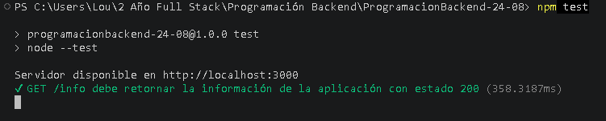
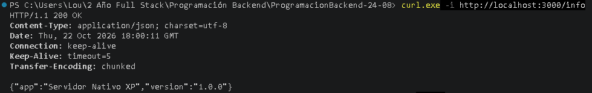

# Desarrollo Backend con Node.js Nativo y XP (TDD)

* **Estudiante:** Tiziana Ochoa
* **Carrera:** 2do Año - Tecnicatura en Programación Full Stack
* **Institución:** Universidad Provincial de Córdoba (UPC)
* **Materia:** Programación Backend

Este proyecto demuestra la implementación de un servidor HTTP básico en Node.js nativo utilizando técnicas de **Extreme Programming (XP)**, específicamente **Test-Driven Development (TDD)** para el desarrollo de un nuevo endpoint.

## 🚀 Tecnologías utilizadas
* **Node.js** (Módulo nativo `node:http`)
* **Runner de pruebas nativo** (`node:test` y `node:assert`)
* **ECMAScript Modules (ESM)** (`import/export`)

---

## 🛠️ Desarrollo del Endpoint `/info` usando TDD

Siguiendo el ciclo de TDD (**Red -> Green -> Refactor**), el desarrollo se llevó a cabo en las siguientes etapas:

### 1. Fase Roja (Red) 🔴
Se escribió primero la prueba unitaria automatizada en `servidor.test.js` para validar la existencia y respuesta del endpoint `GET /info`. Al ejecutar `npm test`, la prueba falló como era esperado (`404 Not Found`), ya que la funcionalidad aún no existía.



### 2. Fase Verde (Green) 🟢
Se agregó el código mínimo necesario dentro de `servidor.js` para responder a la petición `GET /info` con estado `200 OK` y un objeto JSON. Se volvió a ejecutar `npm test` obteniendo un resultado exitoso.



### 3. Verificación Manual 🧪
Se levantó el servidor con `npm start` y se realizó una llamada de prueba desde la terminal mediante `curl.exe`, comprobando el encabezado `HTTP/1.1 200 OK` y el cuerpo JSON esperado.



---

## 📋 Instrucciones de Ejecución

### Ejecutar las pruebas automatizadas
```bash
npm test
